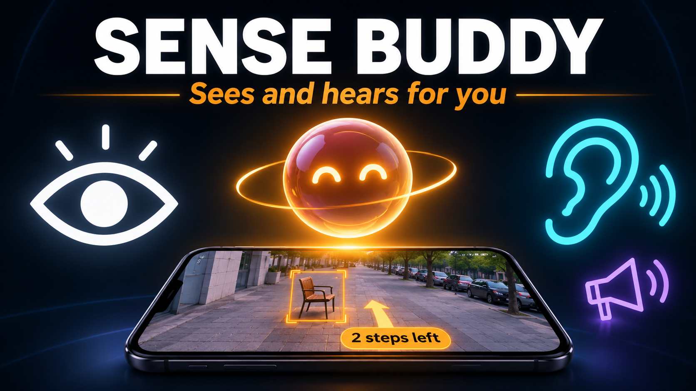

# Sense Buddy (SenseBridge)



An assistive multimodal copilot for people who are visually or hearing impaired.
One friendly orb is the whole interface: it **sees for you** or **hears for you**,
depending on the very first thing it asks you.

> **◉ Visual mode** — talk to the buddy, it talks back. Press one big button (or
> double-tap the orb) and it looks through your camera and guides you in steps
> and directions: *"Empty chair 2 steps ahead to your left"* — never *"a room
> with furniture"*.
>
> **♪ Hearing mode** — the buddy answers in huge on-screen captions. It listens
> for sirens, doorbells, alarms, horns and your name, and tells them apart by
> **vibration pattern** (long triple buzz = siren, double buzz = doorbell)
> plus flashing glanceable alerts.

Built for a hackathon on Meta's stack: **SAM 3** for zero-shot segmentation and
**Llama 4 / Llama 3.3** for spatial reasoning and conversation.

---

## Monorepo layout (pnpm workspaces)

```
sense-buddy/
├── apps/
│   ├── mobile/   Expo SDK 58 + Expo Router + NativeWind (Tailwind) + Reanimated
│   └── api/      Hono + BetterAuth + Drizzle/SQLite — the only place AI keys live
└── packages/
    └── shared/   Zod contracts shared by app & API (requests, responses,
                  haptic patterns, token costs, quick phrases)
```

## How the Meta AI pipeline works

There is no public hosted "Meta API" for Llama/SAM 3, so the API hides two
OpenAI/model-host-compatible providers behind one interface
(`apps/api/src/providers/meta.ts`). Keys never reach the client.

```
Phone camera ──(JPEG ≤720px, base64)──▶ Hono API ──▶ SAM 3 (optional endpoint)
                                              │        masks + labels + bbox
                                              ▼
                                    Llama 4 Scout (vision)
                                    spatial JSON: objects, steps,
                                    directions, hazards
                                              │
                          Visual: expo-speech speaks the guidance
                          Hearing: huge captions + haptic pattern
Ambient listen ─────────────────────▶ Hono API ──▶ Llama reasoning classifies
                                    priority sounds → captions + vibration
```

- **SAM 3** (`SAM3_API_URL`): any HTTPS endpoint accepting
  `{ image, prompt }` and returning `{ objects: [{label, bbox, confidence}] }`
  (Replicate / fal.ai / HF / self-hosted). Mask centroids → direction,
  mask height → distance-in-steps heuristic. If unset, the pipeline degrades
  gracefully to Llama-vision-only grounding (`engine: "llama-vision"`).
- **Llama** (`LLM_*`): OpenRouter / Together / Groq style endpoints.
  Defaults: `meta-llama/llama-4-scout` (vision), `meta-llama/llama-3.3-70b-instruct` (text).
- **Mock mode**: with no `LLM_API_KEY`, every endpoint returns rich scripted
  scenes/sounds so the whole product demos offline. `GET /health` reports
  `aiMode: "mock" | "live"`.

## Auth, quotas & rate limiting (API)

- **BetterAuth** with the Bearer plugin: the app stores the session token in
  SecureStore and sends `Authorization: Bearer …`. Every sign-in returns the
  token in the `set-auth-token` response header.
- **Guests** are real anonymous accounts (BetterAuth anonymous plugin,
  `POST /api/auth/sign-in/anonymous`): temp `@sensebuddy.app` email, name
  asked right after sign-in, rename via `POST /api/auth/update-user`. Linking
  a permanent method later migrates the guest's preferences + usage.
- **Google** is real OAuth when configured: the app gets a Google ID token
  on-device (`expo-auth-session` browser flow, dev build) and the API verifies
  it (`POST /api/auth/sign-in/social` with `idToken`). Needs
  `GOOGLE_*_CLIENT_ID` + `GOOGLE_CLIENT_SECRET` on the API and
  `EXPO_PUBLIC_GOOGLE_*_CLIENT_ID` on the app; without them the button falls
  back to a demo account with a notice.
- **Mock OAuth fallback** (`POST /api/dev/mock-login`, `ALLOW_MOCK_AUTH=false`
  to disable): used only when the real flows are unavailable — Expo Go, or
  OAuth credentials not set. Still creates a real BetterAuth user + session.
- **Token consumption**: every AI call records upstream input/output tokens in
  `usage_event`; users get `DAILY_TOKEN_BUDGET` (default 60k/day). Quota is
  checked *before* spending (`402 quota_exceeded`), balance returned in
  `X-Token-Remaining` and on the Profile screen.
- **Rate limiting**: fixed-window per user+route (e.g. 20/min for `/see`),
  `429` + `Retry-After` + `X-RateLimit-*` headers.

## Running it

```bash
pnpm install

# 1) API (terminal 1)
cp apps/api/.env.example apps/api/.env   # optional: add LLM_API_KEY to go live
pnpm dev:api                             # http://localhost:8787

# 2) Smoke-test the whole backend (terminal 2)
API_URL=http://localhost:8787 pnpm --filter @sense-buddy/api smoke

# 3) Mobile (terminal 3)
pnpm setup:local                         # auto-detects LAN IP → apps/mobile/.env (EXPO_PUBLIC_API_URL)
pnpm dev:mobile                          # scan QR with Expo Go (-- --ip/--port to override setup)
```

Verify everything: `pnpm typecheck` (all workspaces) and
`pnpm --filter @sense-buddy/mobile expo export --platform android`.

## The app experience

- **Onboarding**: two steps, the first real question is *"I can't see well /
  I can't hear well"* — that one answer reshapes the entire UX. The name comes
  after sign-in: guests pick it on the login screen, Google users bring it
  from their profile (both editable later in Settings).
- **Sense**: the orb, a top notch to switch See/Listen/Say, a one-tap
  Profile shortcut in the header, and a chunky bottom menu with
  Sense · Profile on the other pages. Every target ≥ 52–72pt, every control
  labelled for screen readers, `accessibilityLiveRegion` on buddy replies/alerts.
- **See for me**: camera → downscale on-device → spatial guidance spoken aloud,
  hazards in coral, objects listed with direction arrows + step counts.
- **Listen for me**: polls ambient classification every 5s; critical alerts
  flash, vibrate distinctly, and stay until dismissed. *"Feel the difference"*
  lets users learn the patterns.
- **Profile**: live token-budget meter. **Settings**: language (EN/ES/PT/FR),
  appearance (system/light/dark), talking speed, caption size, haptics,
  contrast, name — synced to the API profile.

## Performance choices

- Orb animation runs entirely on the Reanimated UI thread; JS thread stays free.
- Photos are resized to 720px / JPEG 0.6 on-device before upload (smaller
  payload → faster, cheaper inference, less battery).
- TTS is on-device (`expo-speech`) — free, offline, private. Listening polls at
  5s instead of streaming audio.
- Zustand selectors + TanStack Query caching; Hermes bytecode export verified.

## Honest limitations & roadmap

- Speech-to-text input is currently typed/quick-phrase based; on-device STT
  (`expo-speech-recognition`) needs a development build — the voice layer
  (`src/lib/voice.ts`) is the single swap point, as is real ambient audio
  classification (today: API-side; the response contract is already final).
- Real Apple OAuth + native Google SDK (`@react-native-google-signin`) as a
  step up from the browser ID-token flow; SAM 3 hosted endpoint for `sam3+llama`
  engine; push-notification alerts; on-device sound classification for
  background listening; streaming (WebSocket) low-latency guidance.
